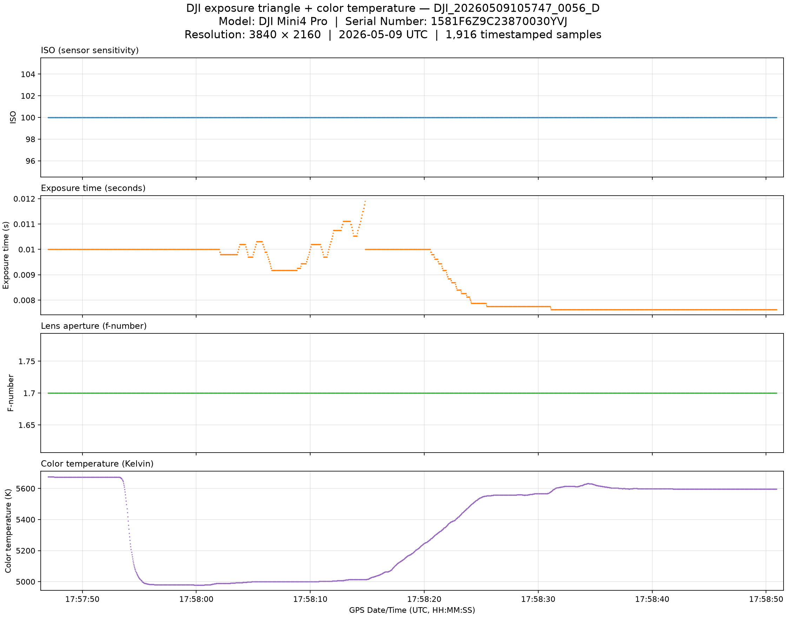
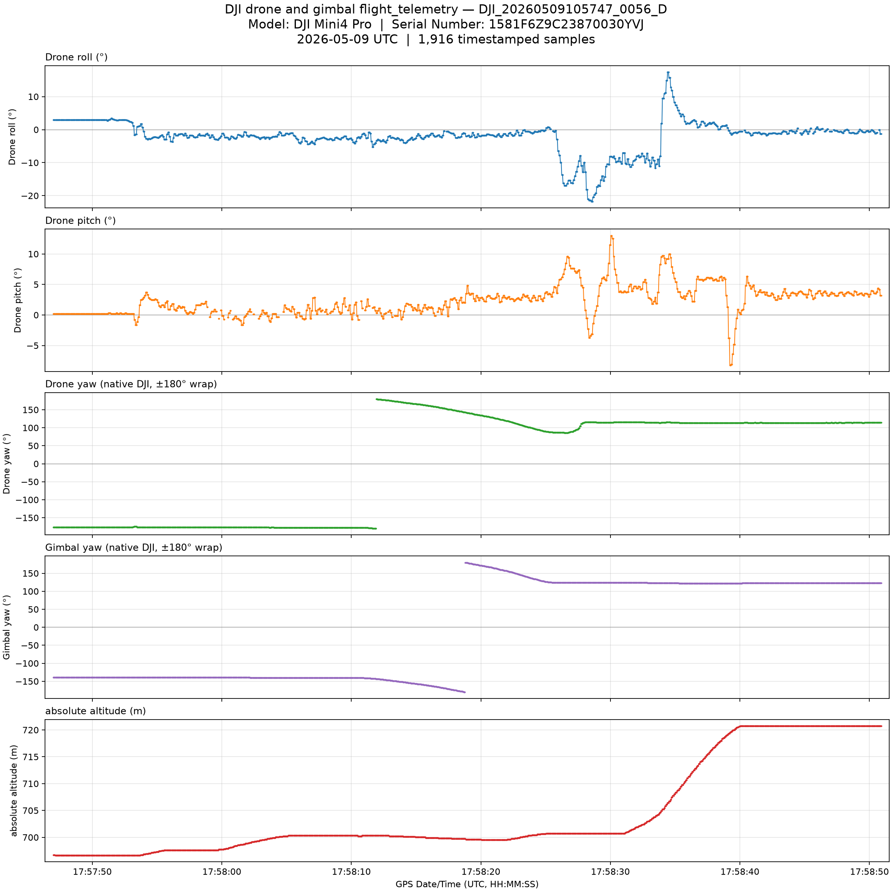

# About

Python script for parsing EXIF data from a DJI video file

Extracts image data and flight telemetry onto standard Matplotlib graph and converts GPS coordinate data to GPX file

Example output for flight telemetry:

Useful for initial diagnosis of GNC issues